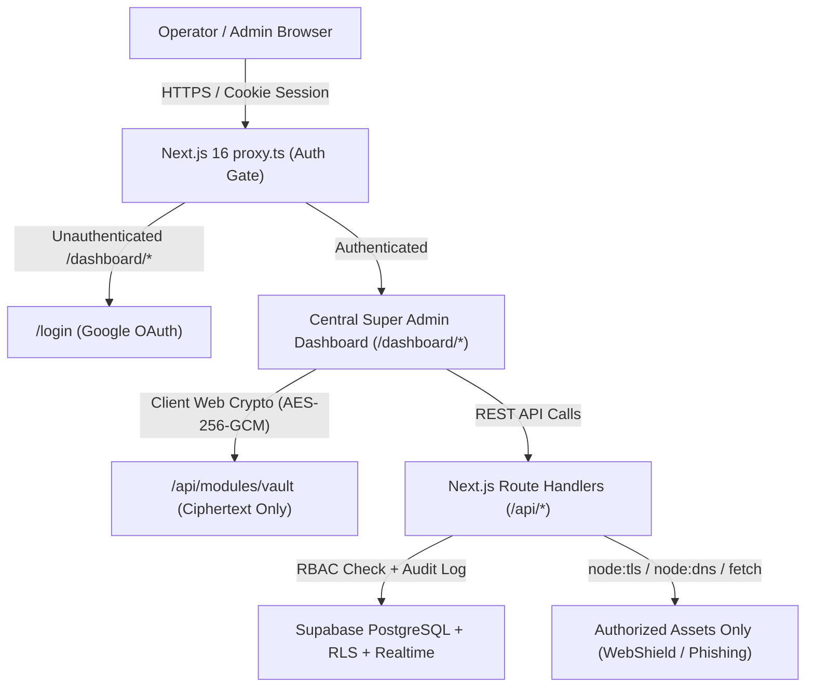
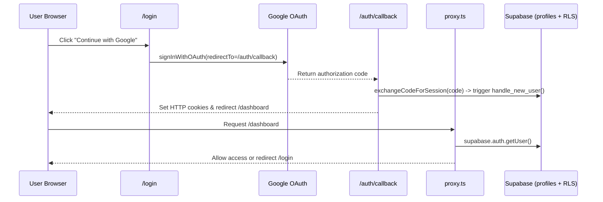

# System Architecture, User Flows & Security Design

## 1. High-Level Architecture

## 2. Authentication & RBAC Flow

## 3. Zero-Knowledge Vault Flow (Module 05)
1. Operator enters a **Vault Passphrase** and secret plaintext in the browser.
2. Browser derives a 256-bit key locally using `PBKDF2 (SHA-256, 100,000 iterations)` + random 16-byte `salt` and encrypts with `AES-256-GCM` + random 12-byte `iv`.
3. Only `{ title, category, ciphertext, iv, salt }` are sent to `POST /api/modules/vault`.
4. PostgreSQL RLS enforces `owner_id = (SELECT auth.uid())`, preventing even `super_admin` from reading or decrypting another operator's vault items.
